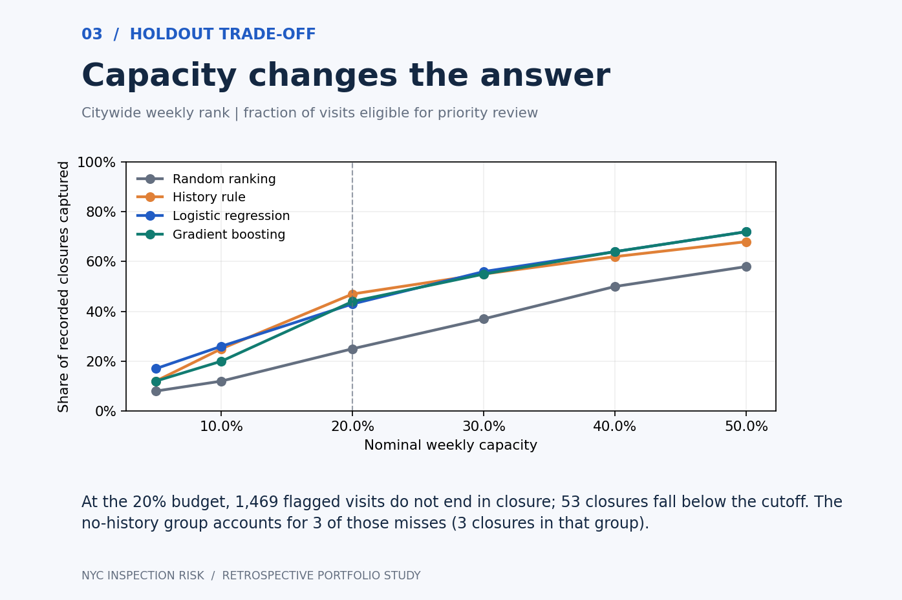

# NYC Inspection Risk

**A weekly prioritization backtest for rare restaurant closures.** At the same 1,516 review slots,
a simple inspection-history rule captured **47 of 100** recorded closures. Logistic regression
captured 43 and gradient boosting captured 44. The more complex models did not improve the decision
we cared about, even though logistic regression had the highest holdout ROC-AUC.

[Findings PDF](reports/findings.pdf) · [Reference metrics](reports/reference/holdout_policy.csv) ·
[Development folds](reports/reference/validation.csv) · [Error slices](reports/reference/holdout_slices.csv)



## Decision and scope

**User:** an inspection operations analyst testing how to prioritize a constrained weekly queue.
**Decision:** flag up to `ceil(0.20 × weekly queue size)` visits for earlier review, without
replacing required inspections. **Target:** whether NYC DOHMH recorded closure at a routine
`Cycle Inspection / Initial Inspection`. This does not predict foodborne illness, non-closure
violations, when a restaurant will be visited, or the effect of changing an inspection schedule.

There is no archived Monday schedule in this extract. The benchmark ranks the routine inspections
that *actually occurred* within each week: an observed-queue replay with candidate membership known
in hindsight. All feature values are frozen on Monday; the queue itself is not a claim about what a
scheduler would have known on Monday. This distinction prevents interpreting coverage as field impact.

## Data contract

The [NYC DOHMH inspection results catalog](https://data.cityofnewyork.us/d/43nn-pn8j) describes a
rolling extract of active establishments and explains why one inspection can occupy several rows.
It also documents `1900-01-01` as a placeholder for establishments not yet inspected. This is a
single denormalized public table, not a linked owner registry or a complete historical census.

The [reference manifest](reports/reference/snapshot.json) records the query, retrieval time and
SHA-256 for **295,671** source rows. We removed 85,356 rows outside the event window or with an
invalid key/date (including 4,085 sentinel rows), then collapsed 123 exact duplicates on the nine
selected fields. The resulting 210,192 rows with recognized actions yielded **60,338** historical
CAMIS-days and **33,715** labeled routine CAMIS-days (454 closures across the entire event window).
The latter counts overlap: routine visits can become history after the delay. See the
[data audit](reports/reference/data_audit.json) for the full reconciliation.

- **Key:** normalize event timestamps to local calendar dates and aggregate by establishment
  identifier (`CAMIS`) and date. For history, collapse any recognized inspection types on a day:
  any closure, maximum usable score, and distinct critical violation codes. No separate visit ID
  is assumed. For targets, use only routine initial rows; exclude a day if its routine action
  is unknown or conflicts on the closure label.
- **Missingness:** retain no-violation inspections. Null or implausible prior scores are missing,
  not zero. The 0–500 score range is a defensive cleaning guardrail, not a regulatory threshold.
  Keep a separate distinction between zero prior inspections and a missing last score.
- **Excluded:** same-visit score, grade, violations and action, post-outcome metadata, record date,
  and business identity. CAMIS joins history and seeds a stable tie-break only. Borough is an
  evaluation slice, not a model feature. No inferred ownership, chain status, or cuisine encoding.

## Point-in-time features and validation

| Feature | Rationale |
|---|---|
| Cumulative and trailing-365-day observed inspection days | History coverage and recent regulatory contact |
| Cumulative and trailing-365-day observed closure days | Prior adverse outcomes and recency |
| Days since last available inspection | Distinguish stale records from recent evidence |
| Last available inspection score, closure and critical-code count | Severity signal from a prior day only |

At the start of week `W` (Monday), allow a historical event only if `event_date <= W − 14 days`.
An as-of join by CAMIS retrieves cumulative counts and last-event values; subtracting older
cumulative counts yields the 365-day features. The first usable scoring week is July 1, 2024,
after a seven-month burn-in from December 1, 2023. The reporting delay is an explicit assumption:
`record_date` describes extraction, not initial publication or revision. NYC also notes that
scores can be revised after adjudication. A lag cannot remove revisions made after the decision
week if only the latest vintage is available. Earlier holdout events can update features after
their delay, but the fitted model is frozen. This is event-time discipline, not verified vintage
reconstruction.

Development uses three expanding folds starting **April 7, July 7, and October 6, 2025**. At each
fit boundary, only earlier visits with labels at least 14 days old are eligible. Model selection also
excludes validation weeks whose Sunday outcomes would not be available at the January 5 lock;
the last validation week starts December 15 at the reference lag. Final fit uses
18,905 eligible visits through December 22, 2025. The later holdout covers decision Mondays from
**January 5 to June 22, 2026** (end June 29 exclusive). A random split would ignore chronology,
and a violation-level split could put the same inspection in both training and testing.

- **Rules:** deterministic pseudo-random ranking, and a non-ML history rule that puts any prior
  closure first, then higher last inspection score, then a fixed outcome-independent tie-break.
- **Learned:** L2-regularized logistic regression with training-only median imputation, missingness
  indicators and scaling (`C ∈ {0.01, 0.1, 1}`); histogram gradient boosting with native missing-value
  handling and a four-setting search over leaf count and L2 penalty. Both rank positive-class scores.
- **Selection:** choose each learned family’s best setting by total closures found across the same
  development queues at equal capacity; break ties by mean fold average precision, then model key.
  Compare the two family champions and the history rule by that same rule before opening holdout.
  Development captures: **52 history / 51 logistic / 45 boosting**, out of 1,932 shared review slots.

## Results and error analysis

**Holdout: 7,522 visits, 100 closures (1.33%), 25 weeks.** Each policy fills 1,516 slots at the
nominal 20% budget because weeks round up individually.

| Ranking policy | Captured | Precision | Recall | Average precision | ROC-AUC |
|---|---:|---:|---:|---:|---:|
| Pseudo-random | 25 | 1.65% | 25% | 0.0160 | 0.555 |
| **History rule (preselected)** | **47** | **3.10%** | **47%** | 0.0283 | 0.647 |
| Logistic regression, C=0.01 | 43 | 2.84% | 43% | **0.0285** | **0.666** |
| Gradient boosting, 7 leaves / L2=10 | 44 | 2.90% | 44% | 0.0280 | 0.646 |

- **Sparse outcomes and shifts:** on development, 19/508 visits with a previously observed closure
  ended in closure (3.74%) versus 249/18,641 without one (1.34%). Quarterly rates range from 0.92%
  to 2.05%; 8,309 development visits had no observable history. Availability depends on cohort
  age and the finite history window. These patterns do not establish causal risk factors.
- **Cost of low precision:** the history rule flagged 1,469 visits without a recorded closure and
  missed 53 closures. Going from 20% to 30% adds 752 flags for eight additional captured closures.
  A non-closure flag is not proof of a wasted inspection; this study values only the named target.
- **Cold start:** all three holdout closures among 264 visits with no available history were missed;
  none of those 264 visits was flagged. Preserve non-model inspection pathways and test a small
  exploration allocation in a prospective replay. Borough capture counts are in the slices table;
  small denominators and differences in inspection mix preclude a fairness certification.
- **Uncertainty:** paired circular 4-week block bootstrap (2,000 draws) estimated gradients minus
  history at −3 captures, approximate 95% interval [−11, +4]; logistic minus history was −4
  [−11, +2]. These intervals describe resampling of 25 observed weeks with fixed models, not refit
  or deployment uncertainty. A 28-day lag sensitivity reruns selection and fit; history remains
  selected and captures 47 (versus 44 logistic and 36 boosting). See [lag sensitivity](reports/lag28/).

**Recommendation:** use the history rule as the comparator in a prospective shadow evaluation.
Before operational use, capture real Monday candidate schedules, effective timestamps for results,
mandatory timing constraints, inspection type and non-closure outcomes. Compare against actual
scheduling practice, track missed and delayed visits, and review slice performance with operators.
Survivorship, retrospective adjudication, an assumed reporting lag, partially observed histories,
and potentially conflated same-day events limit generalization. No savings, avoided illnesses,
calibration, or enforcement impact are claimed.

## Reproduce

Use Python 3.11 (reference) or 3.12. From the repository root:

```sh
python -m venv .venv
# POSIX: source .venv/bin/activate
# Windows PowerShell: .venv\Scripts\Activate.ps1
python -m pip install -e ".[dev]"
python -m inspection_risk fetch
python -m inspection_risk run
python scripts/audit_policy.py runs/reference
python -m inspection_risk report --input runs/reference --output runs/reference
python -m pytest -q
python -m ruff check .
```

To redraw the report **without a fresh query or fit**:

```sh
python -m inspection_risk report --input reports/reference --output runs/rendered
```

The public API updates in place. [Data setup](data/README.md) explains exact cached-input replay
versus a new live snapshot. To rerun the lag sensitivity, use
`python -m inspection_risk run --lag 28 --output runs/lag28`. The SQLite audit independently
recomputes the saved 20% policy counts from ignored row-level holdout predictions.

```text
src/inspection_risk/
  data.py         public API, schema, action mapping, inspection-day grain
  features.py     Monday as-of joins and historical features
  modeling.py     baseline rules, expanding fits, tuning, final holdout
  evaluation.py   capacity policy and evaluation metrics
  diagnostics.py  development EDA, budgets, sliced errors, week bootstrap
  report.py       figures and PDF rebuilt from aggregate tables
scripts/          independent SQLite policy audit
reports/          checked-in aggregate runs, figures and findings PDF
tests/            offline fixtures for data, timing, ranking and model integration
.github/          offline test, lint and report workflow
```

Independent portfolio case study; AI-assisted implementation. Not affiliated with NYC DOHMH.
